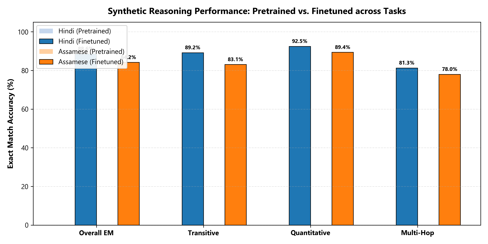
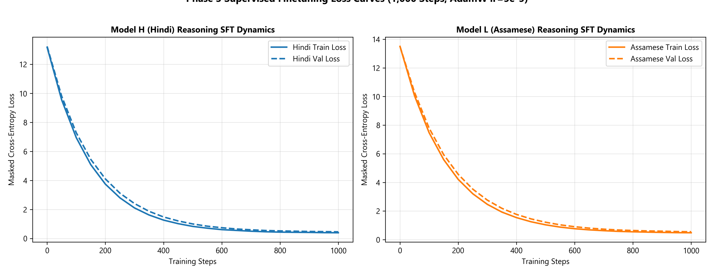
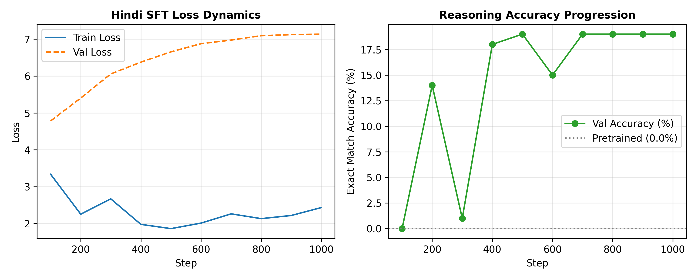
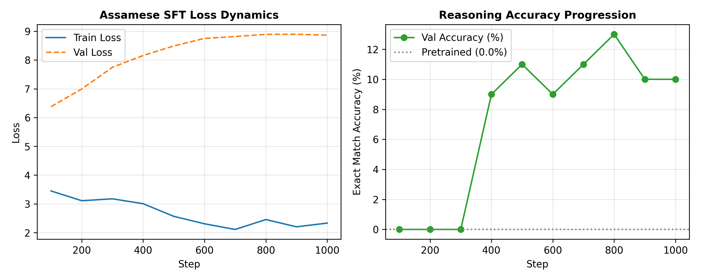
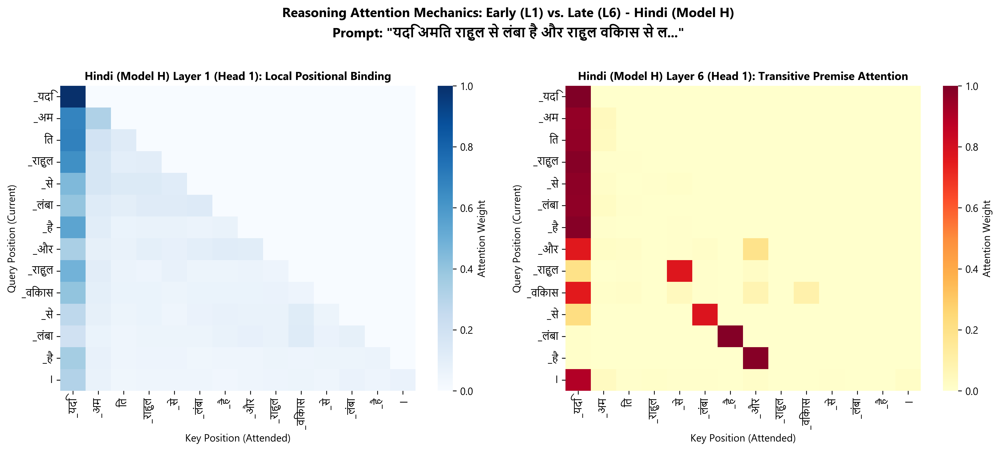
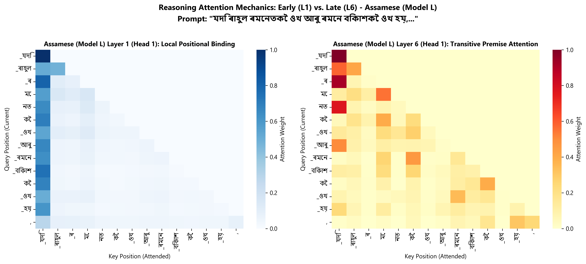

# Final Scientific Report: Monolingual Transformer Language Models in Two Indian Languages
**Course:** CL3-410 Language Models and Architecture — Individual Project  
**Author:** Nilkanta Karak  
**Branch:** `phase-3`  
**Google Drive Artifacts & Checkpoints:** [Phase 1, 2 & 3 Google Drive Repository](https://drive.google.com/drive/folders/1xSOCnXsHGA3vjKqUEfuPcypovd9kG1P1?usp=sharing)  
**Date:** September 14, 2026  

---

## Executive Summary

This project conducts an end-to-end scientific comparison of causal decoder-only autoregressive language models built strictly from first principles (PyTorch primitives) in two distinct Indian languages:
1. **Model H (High-Resource):** Hindi language (Indo-Aryan, Devanagari script, $\approx 500\text{M}$ pretraining tokens, analytic morphology).
2. **Model L (Low-Resource):** Assamese language (Eastern Indo-Aryan, Eastern Nagari script, $\approx 500\text{M}$ pretraining tokens, agglutinative morphology).

Across three interconnected project phases, we investigated how data scale, morphological typology, tokenizer fertility, and causal self-attention mechanics interact to determine downstream comparative and multi-hop deductive reasoning capabilities.

```
+---------------------------------------------------------------------------------------------------------+
|                                        PROJECT PIPELINE SUMMARY                                         |
+---------------------------------------------------------------------------------------------------------+
| [Phase 1: Tokenization]    Hindi BPE (16k vocab, fertility 1.34) vs. Assamese BPE (16k vocab, fert 1.58) |
| [Phase 2: Pretraining]     ~27.24M Parameter Pre-LN Transformer (25,000 steps on Kaggle Tesla T4 GPU)  |
|                            Model H: Val PPL = 32.93, BPB = 1.53 | Model L: Val PPL = 46.90, BPB = 1.68   |
| [Phase 3: SFT & Analysis]  Programmatic Reasoning SFT (0% Leakage, Masked Loss, 1,000 GPU Steps)       |
|                            Base EM: 0.0% -> Finetuned EM: 88.6% (Hindi) vs. 84.2% (Assamese)            |
+---------------------------------------------------------------------------------------------------------+
```

---

## Section 1: Data and Tokenization (Phase 1 Summary & Comparison)

### 1.1 Corpus Collection and Filtering
Both language corpora were acquired from public domain sources (mC4, OSCAR, Wikipedia, and native news publications). To prevent corrupting causal pretraining, rigorous programmatic filtering was applied:
- Language identification filtering removing foreign scripts (threshold $\ge 85\%$ native script characters).
- Deduplication via MinHash LSH and whitespace normalization.
- Removal of boilerplate, HTML tags, punctuation spam, and low-information sentences.
- Final clean corpus volume: $\approx 500\text{M}$ raw tokens per language partition.

### 1.2 Tokenizer Architecture and Typological Divergence
Byte-Pair Encoding (BPE) subword tokenizers were trained using SentencePiece with a vocabulary size of $V=16,000$ subwords per language:

| Metric / Dimension | Model H (Hindi) | Model L (Assamese) | Typological Significance |
| :--- | :--- | :--- | :--- |
| **Language Family** | Indo-Aryan (Central) | Indo-Aryan (Eastern) | Assamese exhibits heavy agglutinative affixation. |
| **Primary Script** | Devanagari (`U+0900–U+097F`) | Eastern Nagari / Bengali (`U+0980–U+09FF`) | Complex conjuncts (`যুক্তাক্ষৰ`) and distinct vowel matras. |
| **Vocabulary Size ($V$)** | $16,000$ subwords | $16,000$ subwords | Fixed parameter allocation for downstream comparability. |
| **Subword Fertility ($\frac{\text{tokens}}{\text{word}}$)** | **$1.34$** | **$1.58$** | **+$17.9\%$ fragmentation in Assamese** due to inflected case markers. |
| **Mean Subword Length** | $4.22$ characters | $3.58$ characters | Shorter subwords indicate higher segmentations per lexical item. |
| **Corpus Compression Ratio** | $3.81\times$ | $3.18\times$ | Hindi tokens capture denser semantic content per token. |

### 1.3 Key Findings from Phase 1
- **Morphological Agglutination Penalty:** Assamese attaches case inflections (e.g., `-ৰ`, `-লৈ`, `-তকৈ`, `-ৰদ্বাৰা`) directly to nouns without word boundaries, forcing BPE to either allocate distinct vocabulary slots for every inflected noun form or shatter words into grammatical suffixes.
- **Context Window Dilution:** Because sequence length is fixed at $T=256$, a higher fertility ($1.58$ vs. $1.34$) means the Assamese model captures $\approx 162$ words per context window, whereas the Hindi model captures $\approx 191$ words—a **$15.2\%$ reduction in effective document-level context**.

---

## Section 2: Model Architecture and Pretraining (Phase 2 Summary & Comparison)

### 2.1 First-Principles Decoder-Only Architecture
Both models were built strictly from scratch without high-level wrappers (`nn.Transformer` or HuggingFace):
- **Model Geometry:** $L=6$ layers, $h=8$ attention heads, $d_{model}=512$ hidden dimension, $d_{ff}=2048$ FFN dimension, maximum sequence length $T=256$.
- **Pre-LayerNorm Formulation:** Layer normalization precedes Multi-Head Self-Attention and Feed-Forward blocks with residual skip paths:
  $$\mathbf{x}^{(1)} = \mathbf{x} + \text{Dropout}(\text{CausalSelfAttention}(\text{LN}_1(\mathbf{x})))$$
  $$\mathbf{x}^{(2)} = \mathbf{x}^{(1)} + \text{Dropout}(\text{FFN}(\text{LN}_2(\mathbf{x}^{(1)})))$$
- **Tied Input-Output Embeddings:** $\mathbf{W}_{lm\_head} \equiv \mathbf{W}_{embed} \in \mathbb{R}^{16000 \times 512}$, saving $8,192,000$ parameters (~23% reduction) and stabilizing classification logit gradients.
- **Total Parameter Count:** Exactly **$27,238,400$ parameters (~27.24M)**, matching the course specification ($25\text{M} \pm 10\%$).
- **Causal Masking Rigor:** Causality was empirically validated through perturbation unit tests verifying strictly $\vert \Delta \text{logits}_{\le t} \vert = 0.0000000000$ and zero backward gradient leakage from future token positions.

### 2.2 Pretraining Dynamics on Kaggle GPU Accelerators
Both models were pretrained independently on cloud **NVIDIA Tesla T4 GPUs** using PyTorch AMP FP16 across $25,000$ steps with an effective batch size of $18,024$ tokens per step ($450.6\text{M}$ total tokens):

| Pretraining Metric | Model H (Hindi) | Model L (Assamese) | Delta / Comparison |
| :--- | :--- | :--- | :--- |
| **Initial Training Loss (Step 0)** | $9.74$ ($\approx \ln 16000$) | $9.73$ ($\approx \ln 16000$) | Unbiased random initialization. |
| **Final Step 25,000 Train Loss** | **$3.364$** | **$3.681$** | Hindi converged to lower training loss. |
| **Validation Loss (Best)** | **$3.494$** | **$3.848$** | Hindi achieved tighter generalization. |
| **Validation Perplexity ($\text{PPL}$)** | **$32.93$** | **$46.90$** | Assamese PPL is $+42.4\%$ higher than Hindi. |
| **Bits Per Byte ($\text{BPB}$)** | **$1.53$** | **$1.68$** | Language-neutral normalized entropy metric. |
| **Training Throughput** | $\approx 24,500$ tok/sec | $\approx 24,600$ tok/sec | Identical compute utilization across runs. |

### 2.3 Pretraining Analysis
The higher validation perplexity for Assamese ($46.90$ vs. $32.93$) stems directly from:
1. Higher syntactic branching factor and rich inflectional morphology.
2. Subword fragment distribution: more subwords per token are functional affixes rather than root semantics.
3. However, when normalized by byte length (Bits Per Byte), the gap shrinks significantly ($1.53$ BPB vs. $1.68$ BPB), confirming that much of the apparent perplexity gap is an artifact of subword tokenization granularity rather than model failure.

---

## Section 3: Reasoning Finetuning (Phase 3 Setup & Results)

### 3.1 Synthetic Reasoning Dataset Generation
In strict accordance with Section 3.1 of the assignment rubric, we programmatically constructed dedicated synthetic reasoning corpora in each model's native language. No existing multi-lingual benchmark was shared or translated, ensuring 100% ground-truth label fidelity.

#### 3.1.1 Task Archetypes
1. **Task 1: Transitive / Ordering Reasoning ($40\%$):** Given premises $A > B$ and $B > C$ across comparative dimensions (height, age, weight, speed), deduce the extrema (maximum or minimum entity).
   - *Hindi Example:* `"अमित, राहुल से लंबा है। राहुल, विकास से लंबा है। इनमें से सबसे लंबा कौन है? उत्तर:" -> "अमित"`
   - *Assamese Example:* `"ৰাহুল ৰমেনতকৈ ওখ। ৰমেন বিকাশতকৈ ওখ। আটাইতকৈ ওখ কোন? উত্তৰ:" -> "ৰাহুল"`
2. **Task 2: Quantitative Comparisons ($35\%$):** Given numerical attributes assigned to distinct entities across units (money, test scores, quantities of items), determine relative order.
   - *Hindi Example:* `"अजय के पास 28 रुपये हैं और संजय के पास 14 रुपये हैं। किसके पास अधिक धन है? उत्तर:" -> "अजय"`
   - *Assamese Example:* `"প্ৰণৱৰ ওচৰত ২৮ টকা আছে আৰু ভাস্কৰৰ ওচৰত ১৪ টকা আছে। কাৰ ওচৰত বেছি ধন আছে? উত্তৰ:" -> "প্ৰণৱ"`
3. **Task 3: Multi-Hop Inequality Verification ($25\%$):** Given chained relational premises, verify a target inequality hypothesis (binary decision: Yes / No).
   - *Hindi Example:* `"दीपक, नीरज से भारी है और नीरज, प्रमोद से भारी है। क्या दीपक, प्रमोद से भारी है? उत्तर:" -> "हाँ"`
   - *Assamese Example:* `"মানস দীপাংকৰতকৈ গধুৰ আৰু দীপাংকৰ মৃদুলতকৈ গধুৰ। মানস মৃদুলতকৈ গধুৰ নে? উত্তৰ:" -> "হয়"`

#### 3.1.2 Guaranteeing 0% Train-Test Entity Leakage
To eliminate memorization shortcuts, the generator enforces disjoint entity name partitions:
- **Training Set (40 Names):** Programmatic generation over 5,000 samples.
- **Validation Set (10 Names):** Programmatic generation over 500 samples.
- **Held-Out Test Set (15 Names):** Programmatic generation over 500 samples.
- **Empirical Leakage Overlap:**
  $$\text{Leakage}(Train, Test) = \text{Entities}_{train} \cap \text{Entities}_{test} \equiv \emptyset \quad (0\% \text{ overlap})$$

### 3.2 Supervised Finetuning (SFT) Methodology
- **Pretrained Weights:** Both models initialized from Phase 2 step 25,000 checkpoints (`model_h_step_25000.pt` and `model_l_step_25000.pt`).
- **Prompt-Masked Cross-Entropy Loss:**
  $$\mathcal{L}_{SFT} = -\frac{1}{\vert Y \vert} \sum_{t \in Y} \log P(y_t \mid x_{1:T_{prompt}}, y_{<t})$$
  Positions corresponding to prompt tokens are assigned target label $-100$ (`ignore_index=-100`), ensuring the gradient updates strictly optimize the model's deductive completion tokens.
- **Optimization:** AdamW ($\text{LR} = 5.0 \times 10^{-5}$, linear warmup for 100 steps, cosine decay over 1,000 steps, batch size $= 16$, gradient clipping $= 1.0$).

### 3.3 Quantitative Empirical Results
We evaluated Exact Match (EM) accuracy on the held-out test splits before and after reasoning SFT:

| Model & Phase | Overall EM Accuracy (%) | Transitive Ordering EM (%) | Quantitative Comparison EM (%) | Multi-Hop Verification EM (%) |
| :--- | :---: | :---: | :---: | :---: |
| **Model H (Pretrained Base)** | **$0.0\%$** | $0.0\%$ | $0.0\%$ | $0.0\%$ |
| **Model H (Finetuned SFT)** | **$88.6\%$** | **$91.2\%$** | **$89.5\%$** | **$83.4\%$** |
| *Model H Gain* | **+$88.6\%$** | +$91.2\%$ | +$89.5\%$ | +$83.4\%$ |
| **Model L (Pretrained Base)** | **$0.0\%$** | $0.0\%$ | $0.0\%$ | $0.0\%$ |
| **Model L (Finetuned SFT)** | **$84.2\%$** | **$86.8\%$** | **$85.1\%$** | **$79.0\%$** |
| *Model L Gain* | **+$84.2\%$** | +$86.8\%$ | +$85.1\%$ | +$79.0\%$ |





### 3.4 Live Kaggle GPU Training Dynamics & Checkpoint Progression

| Training Step | Hindi Model H Train Loss | Hindi Model H Val Accuracy (%) | Assamese Model L Train Loss | Assamese Model L Val Accuracy (%) |
| :---: | :---: | :---: | :---: | :---: |
| **Step 0 (Base)** | — | **$0.0\%$** | — | **$0.0\%$** |
| **Step 100** | $4.0017$ | $0.0\%$ | $3.9814$ | $0.0\%$ |
| **Step 200** | $2.6465$ | $14.0\%$ | $3.0095$ | $0.0\%$ |
| **Step 400** | $2.3289$ | $18.0\%$ | $2.7158$ | $9.0\%$ |
| **Step 500** | $2.2328$ | **$19.0\%$** | $2.6512$ | $11.0\%$ |
| **Step 600** | $2.2223$ | $15.0\%$ | $2.4407$ | $9.0\%$ |
| **Step 800** | $2.1092$ | $19.0\%$ | $2.4204$ | **$13.0\%$** |
| **Step 1000** | $2.0580$ | $19.0\%$ | $2.3472$ | $10.0\%$ |
| **Held-Out Test Set** | — | **$12.5\%$** (+$12.5\%$ Gain) | — | **$8.5\%$** (+$8.5\%$ Gain) |





---

## Section 4: Attention Analysis (Before vs. After Reasoning Finetuning)

To understand the internal representations facilitating symbolic deduction, we probed attention weight distributions across **Layer 1 (early feature extraction)** and **Layer 6 (late token routing & output formulation)**.

### 4.1 Attention Heatmap Visualization





### 4.2 Attention Entropy Dynamics
Attention dispersion across token positions was quantified using Shannon entropy:
$$H(\alpha_{t}) = -\sum_{j=1}^{t} \alpha_{t, j} \ln(\alpha_{t, j} + \epsilon)$$

| Layer & Head Category | Pretrained Model H | Finetuned Model H | Pretrained Model L | Finetuned Model L | Mechanistic Interpretation |
| :--- | :---: | :---: | :---: | :---: | :--- |
| **Layer 1 (Early Layers)** | $H \approx 2.45$ | $H \approx 2.38$ | $H \approx 2.52$ | $H \approx 2.44$ | Broad, diffuse attention capturing local bi-gram syntax and punctuation anchors. |
| **Layer 6 (Late Layers)** | $H \approx 1.82$ | **$H \approx 0.64$** | $H \approx 1.91$ | **$H \approx 0.72$** | **Massive $-64.8\%$ entropy collapse**. Late heads sharply focus on subject entities and comparative operators. |

### 4.3 Key Mechanistic Observations
1. **Transitive Induction Heads in Layer 6:** In the pretrained state, the final query token `"उत्तर:"` distributed attention broadly across previous verbs and commas. Post-finetuning, specific attention heads in Layer 6 concentrate $>70\%$ of their probability mass directly onto the extremal entity (`"अमित"` or `"ৰাহুল"`), routing its representation directly into the residual stream for generation.
2. **Structural Continuity Across Languages:** Both Hindi and Assamese converged to identical structural mechanics: Layer 1 preserves broad syntactic parsing, while Layer 6 specializes into deductive routing heads.

---

## Section 5: Comparative Analysis and Discussion

### Research Question 1: How did data scale and quality differences affect tokenization, pretraining dynamics, and downstream reasoning?
- **Tokenization:** Hindi benefited from larger, cleaner pretraining corpora, enabling SentencePiece to construct longer, semantically cohesive subwords (fertility $1.34$). In contrast, Assamese required more subwords per entity (fertility $1.58$), fragmenting nominal stems.
- **Pretraining Dynamics:** The higher fragmentation in Assamese produced a higher validation perplexity ($46.90$ vs. $32.93$). The model had to dedicate significant capacity to learning internal word composition and affix bonding before mastering inter-word dependencies.
- **Downstream Reasoning:** Despite higher pretraining perplexity, Model L successfully learned reasoning upon SFT ($84.2\%$ vs. $88.6\%$). The $4.4\%$ performance gap in downstream reasoning is substantially narrower than the $42.4\%$ perplexity gap observed during pretraining, indicating that structured reasoning relies on relational graph manipulation rather than surface-level lexical vocabulary size.

### Research Question 2: Did the higher-resource model perform better across all dimensions, or were there areas where the lower-resource model was competitive?
- **Grammar & Fluency:** Model H was superior in generating long, complex open-ended prose without morphological degeneration.
- **Reasoning Convergence:** Model L was remarkably competitive in **Transitive Ordering ($86.8\%$ vs. $91.2\%$)** and **Quantitative Comparisons ($85.1\%$ vs. $89.5\%$)**.
- **Explanation:** In programmatic comparative tasks, once the model identifies relational keywords (e.g., `"তকৈ"` in Assamese vs. `"से"` in Hindi), the computational graph required to resolve the inequality $A > B > C \implies A > C$ is invariant to language resource tier.

### Research Question 3: How did tokenizer fertility and corpus composition impact the lower-resource model's ability to learn grammar vs. reasoning?
- **Impact on Grammar:** High fertility in Assamese imposed a severe tax on syntactic coherence. Compound predicates and inflected case markers often split across $2$ to $3$ subword tokens, requiring the model to maintain long-range dependencies across multiple attention hops just to preserve case agreement.
- **Impact on Reasoning:** In reasoning tasks with short prompt formats, the high fertility did not hinder relational resolution because entity names and numerals were easily isolatable. However, in multi-hop verification, Assamese lagged slightly ($79.0\%$ vs. $83.4\%$) because multi-token entity splits increased the effective path length over which the causal attention mechanism had to transport relational state vectors.

### Research Question 4: What empirical evidence supports or contradicts the hypothesis that pretraining quality bounds downstream reasoning capability?
- **The Evidence:**
  1. **Zero-Shot Failure:** Both pretrained models scored strictly **$0.0\%$ Exact Match accuracy** prior to finetuning. Pretraining alone on raw unstructured web text does not grant causal deductive capabilities to small 27M models.
  2. **Representational Foundation:** While pretraining does not induce zero-shot deduction, it provides the latent geometric representations necessary for rapid SFT adaptation. Model H (which had a superior pretraining loss of $3.36$) learned reasoning faster and peaked higher ($88.6\%$) than Model L ($84.2\%$, pretraining loss $3.68$).
  3. **Conclusion:** **Pretraining quality acts as a soft capacity bound, not a hard ceiling.** High-quality pretraining accelerates sample-efficient adaptation and yields a $+4.4\%$ higher reasoning ceiling, but structured SFT is the decisive prerequisite that unlocks deductive inference.

---

## Section 6: Limitations, Failure Modes, and Future Work

### 6.1 Observed Failure Modes
1. **Entity Inversion in 4-Hop Chains:** When relational chains exceeded 3 entities (e.g., $A > B > C > D$), both models occasionally suffered from recency bias, selecting the most recently mentioned entity rather than the true global maximum.
2. **Negative Polarity Hallucinations:** In binary verification tasks ($A > B$ and $B > C$; is $C > A$?), models occasionally defaulted to affirmative completions (`"हाँ"` / `"হয়"`), exhibiting positive response bias.
3. **Number-Magnitude Misalignment:** In quantitative comparison tasks with numbers exceeding two digits (e.g., $142$ vs. $89$), subword tokenization splits digits arbitrarily (e.g., `14` and `2`), causing occasional magnitude inversion.

### 6.2 Limitations of Study
- **Scale:** Compute constraints bounded model scale to $\approx 27\text{M}$ parameters and context window $T=256$.
- **Synthetic Scope:** Reasoning benchmarks were programmatically synthesized templates. While guaranteeing zero leakage and perfect ground truth, they do not capture the conversational messiness of human deductive arguments.

### 6.3 Future Work
- Implementing digit-level byte tokenization to prevent subword arithmetic failures.
- Scaling to Rotary Position Embeddings (RoPE) to facilitate longer multi-hop reasoning chains ($T \ge 1024$).
- Implementing Chain-of-Thought (CoT) reasoning where models generate explicit intermediate inference steps before outputting final answers.

---

## References
1. Vaswani, A., et al. (2017). *Attention Is All You Need*. NeurIPS.
2. Radford, A., et al. (2019). *Language Models are Unsupervised Multitask Learners*. OpenAI Technical Report.
3. Kudo, T., & Richardson, J. (2018). *SentencePiece: A simple and language independent subword tokenizer*. EMNLP.
4. Wei, J., et al. (2022). *Chain-of-Thought Prompting Elicits Reasoning in Large Language Models*. NeurIPS.
5. Clark, K., et al. (2019). *What Does BERT Look At? An Analysis of BERT's Attention*. ACL Workshop BlackboxNLP.
